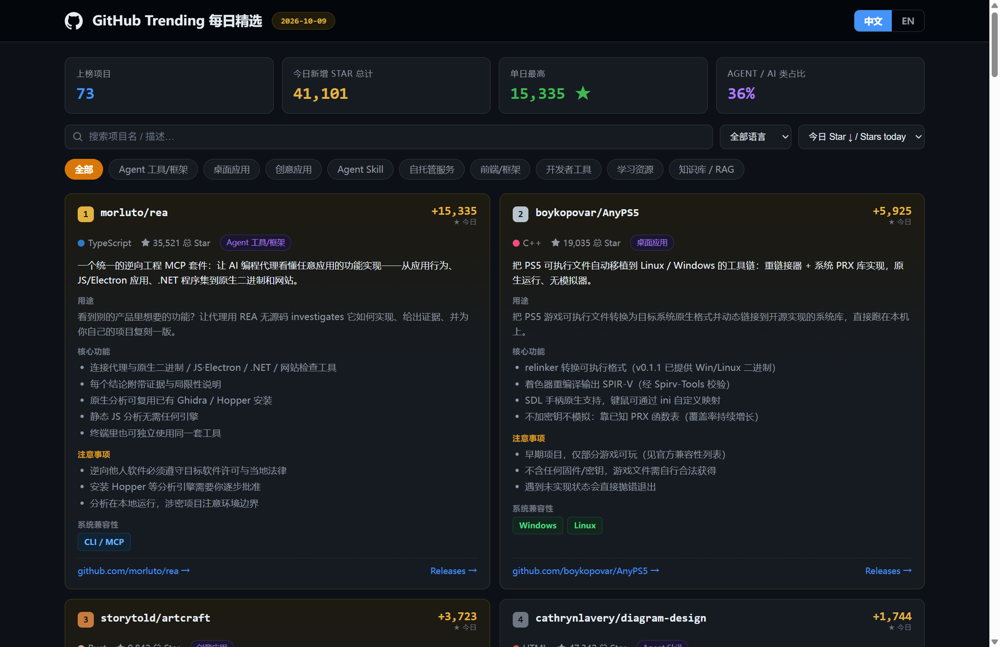

# GitHub Trending Daily

**简体中文** | [English](#english)

> 把每天 GitHub Trending 变成一份**中英双语、可交互**的 HTML 日报：按**今日新增 Star** 排序，逐项目讲解用途 / 功能 / 注意事项 / 操作系统兼容性，附官方跳转链接。
>
> An AI-agent skill that turns the daily GitHub Trending into a **bilingual (中文 / English) interactive HTML digest**, sorted by **stars gained today**, with per-project purpose, features, caveats and OS compatibility.

---



## ✨ 特性 / Features

- 🏆 **按今日 Star 增量排序**——不是总星榜，是"今天谁最火" / Sorted by stars gained **today**
- 🗂 **精选 Top 20 卡片**：用途、核心功能、注意事项（合规 / 资源消耗 / 版本陷阱）、系统兼容性 badge、仓库与 Releases 链接 / Featured cards with purpose, features, caveats, OS badges and links
- 🌐 **中英一键切换**，偏好写入 localStorage / One-click zh-EN toggle, persisted
- 🔍 搜索 + 分类筛选 + 多种排序 + 表头点击重排 / Search, category chips, sorting, sortable table
- 🌙 深色数据密集仪表盘风格，**零外部依赖**——单文件 HTML，离线双击即开 / Dark data-dense dashboard, zero external requests, works offline
- 🛰 **多通道抓取策略**：GitHub API 直连 + WebFetch 榜单 + 语言子页补全，内置国内网络环境踩坑记录 / Multi-channel fetching with documented workarounds for restricted networks

## 📁 目录结构 / Structure

```
github-trending-daily/
├── SKILL.md                          # Agent 工作流主文件 / skill entry
├── scripts/
│   └── fetch_details.py              # 抓 README 摘要 + Release 附件（纯标准库 / stdlib only）
├── references/
│   └── report-template.html          # 报告模板（含完整交互逻辑 / full interactive template）
└── docs/                             # 截图 / screenshots
```

## 🚀 快速开始 / Quick Start

### 作为 Agent Skill 使用 / As an agent skill

把本目录复制到你的 agent 技能目录，然后在对话里说 *"做今天的 GitHub Trending 日报"*：

```bash
# WorkBuddy
cp -r github-trending-daily ~/.workbuddy/skills/

# Claude Code
cp -r github-trending-daily ~/.claude/skills/
```

`SKILL.md` 会驱动 agent 完成：抓榜单 → 补详情 → 撰写双语讲解 → 生成 HTML。

### 手动跑详情脚本 / Run the enrichment script manually

```bash
# repos.txt：每行一个 owner/repo，行尾加 * 表示同时抓 Release 附件
#   morluto/rea
#   boykopovar/AnyPS5 *
python scripts/fetch_details.py repos.txt out.json
```

- 仅依赖 Python 标准库（3.8+），无需 pip 安装任何包 / stdlib only, no pip deps
- 匿名限额 60 次/小时：精选 20 个仓库 + 10 个 Release ≈ 50 次调用 / unauthenticated GitHub API limit is 60 req/h

### 生成报告 / Generate the report

以 `references/report-template.html` 为骨架，替换其中 `DATA`（精选卡片）与 `MORE`（完整榜单）两个数组即可，交互逻辑（双语切换 / 搜索 / 筛选 / 排序）已全部内置。

## 🖥 OS 兼容性判定规则 / OS detection rules

| 证据 / Evidence | 结论 / Verdict |
|---|---|
| Release 含 `.exe` / `.msi` | Windows |
| Release 含 `.dmg` / `.pkg` | macOS |
| Release 含 `AppImage` / `.deb` / `.rpm` | Linux |
| Release 含 `.apk` | Android |
| README 说明 Docker 部署 | Docker / 自托管 |
| Agent Skill / 文档 / 前端库 | 系统无关（OS-free） |
| Go / Rust / Node 单二进制 CLI | Windows + macOS + Linux |

优先级：Release 附件 > README 安装说明 > 语言生态推断。

## ⚠️ 说明 / Notes

- 星数为抓取时刻快照，非精确统计 / Star counts are a snapshot at fetch time
- GitHub Trending 榜单本身按总星排序，本工具统一按**今日新增**重排 / The board is re-sorted by daily gain
- `fetch_details.py` 只读取公开 API，不上传任何本地数据 / Read-only public API, nothing uploaded
- 请遵守目标项目的许可与当地法律使用抓取内容 / Respect licenses of referenced projects

## 📄 License

[MIT](LICENSE)

---

<a id="english"></a>

# GitHub Trending Daily (English)

> Turn the daily GitHub Trending into a **bilingual, interactive HTML digest**: sorted by **stars gained today**, with per-project purpose, key features, caveats and OS compatibility, plus links to the repo and releases.

## Features

- 🏆 Sorted by **stars gained today** (not all-time stars)
- 🗂 **Top 20 featured cards**: purpose, features, caveats (compliance / resource cost / version pitfalls), OS-compatibility badges, repo & releases links
- 🌐 **One-click 中文 / English toggle**, persisted in localStorage
- 🔍 Search, category filters, sorting, clickable table headers
- 🌙 Dark data-dense dashboard, **zero external requests** — single-file HTML that opens offline
- 🛰 Multi-channel fetching strategy (GitHub API + WebFetch + per-language trending pages) with documented workarounds for restricted networks

## Quick start

**As an agent skill** — copy this folder into your agent's skills directory (`~/.workbuddy/skills/` for WorkBuddy, `~/.claude/skills/` for Claude Code), then just ask: *"make today's GitHub Trending digest"*. `SKILL.md` drives the whole pipeline.

**Enrichment script** (stdlib only, Python 3.8+):

```bash
# repos.txt: one "owner/repo" per line; append " *" to also fetch release assets
python scripts/fetch_details.py repos.txt out.json
```

Unauthenticated GitHub API limit is 60 req/hour — ~20 featured repos + ~10 release lookups fits comfortably.

**Report generation** — use `references/report-template.html` as the skeleton and replace the `DATA` (featured cards) and `MORE` (full ranking) arrays; all interactions are built in.

## Notes

- Star counts are a snapshot at fetch time
- The upstream board is sorted by total stars; everything here is re-sorted by daily gain
- The script only reads public APIs; nothing is uploaded
- Respect the licenses of referenced projects

## License

[MIT](LICENSE)
